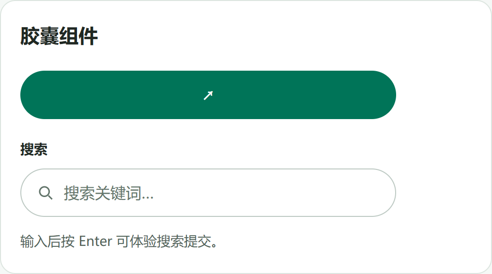
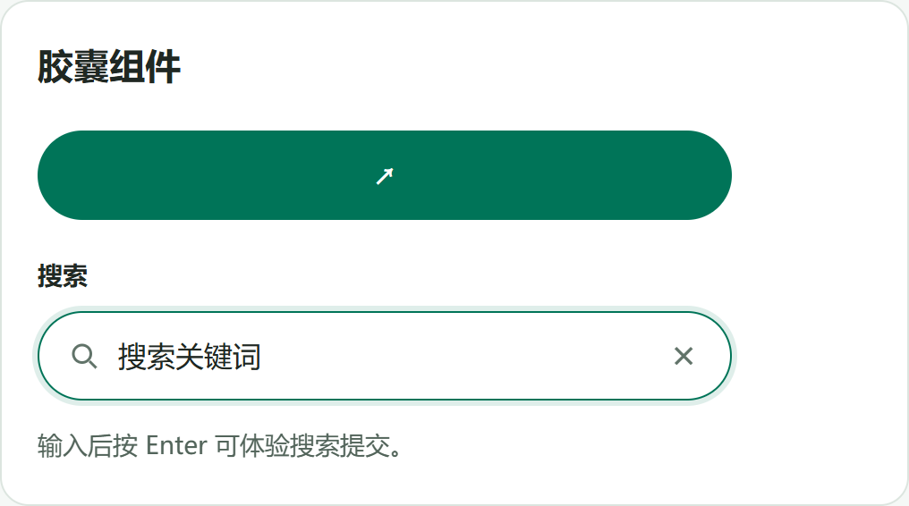
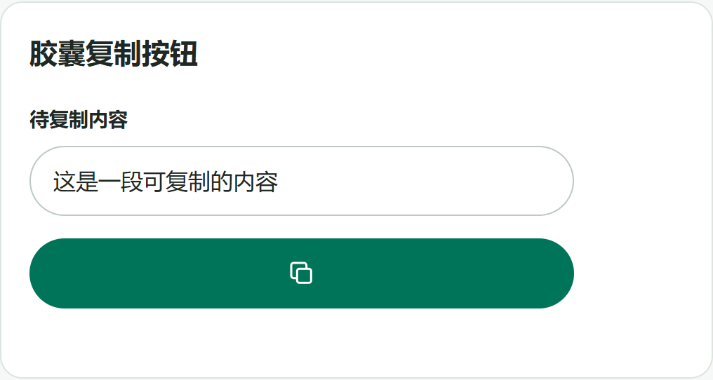

# 组件库

原生 HTML / CSS / JavaScript 组件，无框架、无构建步骤、无外部依赖。下载后直接打开 `index.html` 预览。

## 样式预览

### 默认状态



### 点击输入后的状态

搜索框内部没有额外边框，只有外层轮廓高亮。



### 胶囊复制按钮

按钮只显示复制图标，复制成功后变成对勾，并在按钮下方提示“已复制”。颜色沿用胶囊按钮配置。



## 核心 CSS 样式

以下为样式要点，完整可复用样式见 [components.css](components.css)。

```css
/* 两端完全圆角。 */
.ui-pill-button,
.ui-search {
  box-sizing: border-box;
  width: 100%;
  min-height: 50px;
  border-radius: 9999px;
}

/* 胶囊按钮。 */
.ui-pill-button {
  display: inline-flex;
  align-items: center;
  justify-content: center;
  gap: 6px;
  padding: 12px 24px;
  border: 0;
  background: #007458;
  color: #fff;
  font-weight: 700;
  cursor: pointer;
}

/* 搜索框外层。 */
.ui-search {
  display: flex;
  align-items: center;
  gap: 10px;
  padding: 0 16px;
  border: 1px solid #bdc9c3;
  background: #fff;
}

/* 输入区域始终无内框，包括点击和键盘聚焦时。 */
.ui-search .ui-search__input,
.ui-search .ui-search__input:focus,
.ui-search .ui-search__input:focus-visible {
  flex: 1;
  min-width: 0;
  padding: 12px 0;
  border: 0;
  outline: none;
  box-shadow: none;
  border-radius: 0;
  background: transparent;
  font: inherit;
  font-size: 16px;
}

/* 聚焦提示统一显示在外层。 */
.ui-search:focus-within {
  border-color: #007458;
  box-shadow: 0 0 0 3px #00745820;
}

.ui-pill-button:focus-visible {
  outline: 3px solid #5bd4b3;
  outline-offset: 3px;
}
```

## 包含内容

- 胶囊按钮：无可见文字、保留箭头，支持自定义颜色、悬停、键盘焦点和禁用样式。
- 胶囊搜索框：输入区始终无边框、无 outline、无阴影；聚焦提示统一显示在外层容器。
- 搜索词清除按钮，清除后焦点返回输入框。
- 胶囊复制按钮：无可见文字、复制图标、成功对勾、空内容与失败反馈。

演示按钮与搜索提交只更新本地提示，不会发送申请或请求搜索服务。

复制按钮会将指定内容写入剪贴板。

## 引入

```html
<link rel="stylesheet" href="components.css">
<script src="components.js" defer></script>
```

## 胶囊按钮

```html
<button class="ui-pill-button" type="button" aria-label="申请配置">
  <span aria-hidden="true">↗</span>
</button>
```

按钮不显示文字，`aria-label` 仅供读屏软件识别，接入时改成实际操作名称。跳转页面时使用 `<a class="ui-pill-button" href="/apply" aria-label="申请配置"><span aria-hidden="true">↗</span></a>`。

## 胶囊搜索框

```html
<label for="search-keyword">搜索</label>
<div class="ui-search" data-ui-search>
  <input id="search-keyword" class="ui-search__input"
         type="text" inputmode="search" enterkeyhint="search"
         placeholder="搜索关键词…">
  <button class="ui-search__clear" type="button"
          aria-label="清除搜索词" hidden>×</button>
</div>
```

输入框使用 `type="text"`，避免部分浏览器为搜索类型附加内置装饰。清除功能由可选的 `components.js` 提供；实际搜索逻辑由接入项目实现。需要 Enter 提交时，将搜索框放进 `<form>` 并监听 `submit`。

## 胶囊复制按钮

引入 `components.css` 和 `components.js` 后即可使用：

```html
<button class="ui-pill-button ui-copy" type="button"
        data-ui-copy data-copy-text="这里填写要复制的内容"
        aria-label="复制内容">
  <svg class="ui-copy__icon ui-copy__idle" viewBox="0 0 24 24"
       fill="none" stroke="currentColor" stroke-width="1.8" aria-hidden="true">
    <rect x="8" y="8" width="12" height="12" rx="2"/>
    <path d="M16 8V5a2 2 0 0 0-2-2H5a2 2 0 0 0-2 2v9a2 2 0 0 0 2 2h3"/>
  </svg>
  <svg class="ui-copy__icon ui-copy__done" viewBox="0 0 24 24"
       fill="none" stroke="currentColor" stroke-width="2" aria-hidden="true">
    <path d="m5 12 4 4L19 6"/>
  </svg>
</button>
```

复制输入框或其他元素的内容时，将 `data-copy-text` 替换为 `data-copy-target="元素ID"`（不带 `#`）。目标为输入框时读取当前 `value`，其他元素读取 `textContent`。同时提供两项时优先读取目标元素。

脚本会在按钮后添加状态提示。使用 HTTPS 或 localhost 时优先调用 Clipboard API；无该 API 时尝试浏览器兼容复制方式。权限被拒绝或复制不可用时显示失败，不会误报成功。成功反馈在 3 秒后复原。

## 自定义

### 按钮颜色

直接引用时默认显示绿色（`#007458`），并非固定只能使用绿色。接入项目后，可在 `components.css` 之后添加以下配置，自行替换颜色值：

```css
.ui-pill-button {
  --ui-accent: #2563eb;       /* 默认背景色：示例为蓝色 */
  --ui-accent-hover: #1d4ed8; /* 鼠标悬停背景色 */
  --ui-focus: #93c5fd;        /* 键盘聚焦轮廓色 */
  color: #fff;               /* 箭头或后续添加的文字颜色 */
}
```

以上代码统一修改所有胶囊按钮；只修改某一个按钮时，为它添加自定义类，并使用 `.ui-pill-button.my-button` 作为选择器。演示保留默认绿色。

### 尺寸

```css
/* 默认铺满父容器，按需限制宽度。 */
.my-component { max-width: 388px; }
```

默认胶囊圆角为 `9999px`，最小高度为 `50px`。组件样式使用 `ui-` 前缀；建议在项目的全局表单样式之后引入。内层输入框不显示焦点框，但外层仍有 `:focus-within` 高亮，方便键盘定位。
