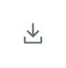
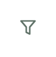
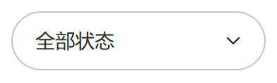

# 组件库

按钮、搜索框、复制图标、导出图标、筛选图标、下拉选择框分别存放，互不依赖；每个组件都能单独引入、单独预览。按钮、搜索框和下拉选择框为胶囊圆角，复制、导出与筛选显示小图标，颜色可自行配置。

## 样式预览

### 按钮


### 搜索框


### 复制图标


### 导出图标



### 筛选图标



### 下拉选择框



## 通用分布式部署

独立部署工具：[通用分布式部署](deployment/README.md)。不同技术栈通过容器镜像和一份配置复用；数据库可选 PostgreSQL 高可用或 TiDB 分布式模式。详见该目录的接入条件与验证范围。

## 按钮用法


源码：[button/button.css](button/button.css) · 独立演示：[button/index.html](button/index.html)

只需要按钮自己的 CSS，无需 JavaScript。

```html
<link rel="stylesheet" href="button/button.css">
<button class="ui-pill-button" type="button" aria-label="申请配置"><span aria-hidden="true">↗</span></button>
```

只保留箭头，不显示文字。接入项目时把 `aria-label` 改成实际操作名称，并绑定所需操作。

## 搜索框用法

源码：[search/search.css](search/search.css)、[search/search.js](search/search.js) · 独立演示：[search/index.html](search/index.html)

```html
<link rel="stylesheet" href="search/search.css">
<script src="search/search.js" defer></script>
<div class="ui-search" data-ui-search>
  <svg class="ui-search__icon" viewBox="0 0 24 24" fill="none" stroke="currentColor" stroke-width="2" aria-hidden="true"><circle cx="10.5" cy="10.5" r="6.5"/><path d="m16 16 5 5"/></svg>
  <input class="ui-search__input" type="text" inputmode="search" enterkeyhint="search" placeholder="搜索关键词…" aria-label="搜索关键词">
  <button class="ui-search__clear" type="button" aria-label="清除搜索词" hidden>×</button>
</div>
```

内部输入区无边框，点击或键盘聚焦时只高亮外层。JavaScript 提供清除功能；实际搜索逻辑由接入项目实现。

## 复制图标用法

源码：[copy-button/copy-button.css](copy-button/copy-button.css)、[copy-button/copy-button.js](copy-button/copy-button.js) · 独立演示：[copy-button/index.html](copy-button/index.html)

只引入复制图标自己的文件，不需要普通按钮或搜索框。图标为 18px，无背景、无边框，默认点击区域为 32 × 32px，不占整行。

```html
<link rel="stylesheet" href="copy-button/copy-button.css">
<script src="copy-button/copy-button.js" defer></script>
<button class="ui-copy" type="button" data-ui-copy data-copy-text="这是一段可复制的内容" aria-label="复制内容">
  <svg class="ui-copy__icon ui-copy__idle" viewBox="0 0 24 24" fill="none" stroke="currentColor" stroke-width="1.8" aria-hidden="true"><rect x="8" y="8" width="12" height="12" rx="2"/><path d="M16 8V5a2 2 0 0 0-2-2H5a2 2 0 0 0-2 2v9a2 2 0 0 0 2 2h3"/></svg>
  <svg class="ui-copy__icon ui-copy__done" viewBox="0 0 24 24" fill="none" stroke="currentColor" stroke-width="2" aria-hidden="true"><path d="m5 12 4 4L19 6"/></svg>
</button>
```

通过 `data-copy-text` 设置复制内容；也可替换为 `data-copy-target="元素ID"`（不带 #），复制指定输入框的 value 或普通元素的 textContent。两者同时存在时优先读取目标元素。

成功后图标变为对勾，按钮下方提示“已复制”，3 秒后复原。空内容与失败会显示对应提示。优先使用 HTTPS/localhost 下的 Clipboard API，无该 API 时尝试兼容方式。

## 导出图标用法

源码：[export-button/export-button.css](export-button/export-button.css)、[export-button/export-button.js](export-button/export-button.js) · 独立演示：[export-button/index.html](export-button/index.html)

与复制图标相同：18px 图标、32 × 32px 点击区域，无文字、无背景、无边框。触屏点击区域扩大到 44 × 44px。

```html
<link rel="stylesheet" href="export-button/export-button.css">
<script src="export-button/export-button.js" defer></script>

<button class="ui-export" type="button" data-ui-export
        data-export-target="export-data" data-export-format="csv"
        data-export-filename="数据列表" aria-label="导出数据">
  <svg class="ui-export__icon" viewBox="0 0 24 24" fill="none"
       stroke="currentColor" stroke-width="1.8" stroke-linecap="round"
       stroke-linejoin="round" aria-hidden="true">
    <path d="M12 3v12m-5-5 5 5 5-5M4 16v4a1 1 0 0 0 1 1h14a1 1 0 0 0 1-1v-4"/>
  </svg>
</button>
<script type="application/json" id="export-data">
  [{"名称":"示例 A","状态":"启用"}]
</script>
```

`data-export-target` 指向数据元素的 ID（不带 #）。点击时读取最新内容；更新数据可通过 `document.getElementById('export-data').textContent = JSON.stringify(rows)`。动态数据请使用 textContent，避免拼接不可信 HTML。

`data-export-format` 可选 `csv`（默认）或 `json`，文件扩展名自动匹配。CSV 支持平面对象数组，自动处理中文 BOM、引号、逗号和换行；可能被表格软件当作公式的字符串会加单引号作为文本导出。嵌套结构使用 JSON。组件只导出当前传入的数据，不自动请求全部分页数据，也不生成 XLSX。

下载在浏览器本地触发。提示“已开始下载”表示已发起下载，并不代表用户已经保存文件；空数据或格式错误时显示提示。可监听 `ui:export` 事件获取 `event.detail.filename` 和 `format`。

## 筛选图标用法

源码：[filter-button/filter-button.css](filter-button/filter-button.css) · 独立演示：[filter-button/index.html](filter-button/index.html)

与复制、导出图标相同：18px 图标、32 × 32px 点击区域，无文字、无背景、无边框，触屏点击区域为 44 × 44px。只需独立 CSS，不依赖其他组件或图标库。

```html
<link rel="stylesheet" href="filter-button/filter-button.css">
<button class="ui-filter" type="button" aria-label="筛选" id="filter-button">
  <svg class="ui-filter__icon" viewBox="0 0 24 24" fill="none"
       stroke="currentColor" stroke-width="1.8" stroke-linecap="round"
       stroke-linejoin="round" aria-hidden="true">
    <path d="M4 4h16l-6 7v8l-4-2v-6L4 4Z"/>
  </svg>
</button>
```

这是独立的筛选入口图标，不预设业务筛选条件。接入时给按钮绑定 `click`，打开项目自己的筛选面板或执行筛选逻辑。独立演示只反馈点击；若绑定展开面板，请同步维护 `aria-expanded` 和 `aria-controls`。

## 分别配置颜色

下拉选择框用法见下方，各组件颜色可分别配置。

直接引用时普通按钮默认绿色，复制图标默认灰绿色。以下配置放在组件 CSS 后面，分别修改，互不影响：

```css
/* 普通按钮。 */
.ui-pill-button {
  --ui-accent: #2563eb;
  --ui-accent-hover: #1d4ed8;
  --ui-focus: #93c5fd;
  color: #fff;
}

/* 复制图标。 */
.ui-copy {
  --ui-copy-color: #617369;
  --ui-copy-hover: #007458;
  --ui-focus: #5bd4b3;
}

/* 导出图标。 */
.ui-export {
  --ui-export-color: #617369;
  --ui-export-hover: #007458;
  --ui-focus: #5bd4b3;
}

/* 筛选图标。 */
.ui-filter {
  --ui-filter-color: #617369;
  --ui-filter-hover: #007458;
  --ui-focus: #5bd4b3;
}

/* 下拉选择框。 */
.ui-select {
  --ui-select-color: #202823;
  --ui-select-background: #fff;
  --ui-select-border: #bdc9c3;
  --ui-select-focus: #007458;
}
```

按钮和搜索框默认宽度为父容器的 100%，最小高度为 50px，圆角为 9999px，可分别设置 max-width。各图标保持紧凑尺寸，触屏设备上点击区域为 44 × 44px，图标本身仍为 18px。下载后打开各目录的 index.html 可独立预览，根目录 index.html 按一行一个组件展示。

## 下拉选择框用法

源码：[dropdown-select/dropdown-select.css](dropdown-select/dropdown-select.css) · 独立演示：[dropdown-select/index.html](dropdown-select/index.html)

控件显示当前选项，点击展开多个选项，选中后自动更新显示。胶囊外框、右侧下箭头、内部无额外边框；默认宽 180px。原生 select 自带键盘选择、表单提交和移动端选项界面，不需要额外 JavaScript。

```html
<link rel="stylesheet" href="dropdown-select/dropdown-select.css">
<div class="ui-select">
  <select class="ui-select__control" id="status-select" name="status" aria-label="选择状态">
    <option value="all">全部状态</option>
    <option value="enabled">启用</option>
    <option value="disabled">停用</option>
    <option value="pending">待审核</option>
  </select>
  <svg class="ui-select__arrow" viewBox="0 0 24 24" fill="none"
       stroke="currentColor" stroke-width="1.8" stroke-linecap="round"
       stroke-linejoin="round" aria-hidden="true">
    <path d="m6 9 6 6 6-6"/>
  </svg>
</div>
```

替换 option 的文字和值即可配置选项。设置 `selected` 指定默认项，给 select 加 `disabled` 可禁用。需要根据选择加载数据时监听 `change`，通过 `event.target.value` 读取选中值；它不会自动替业务列表执行筛选。展开菜单的外观由浏览器/系统提供。

```js
document.getElementById('status-select').addEventListener('change', event => {
  console.log('选中值：', event.target.value);
});
```
