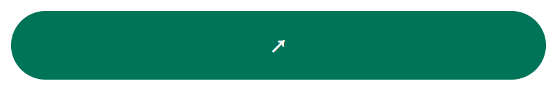
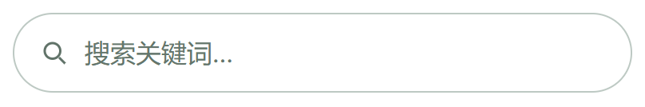
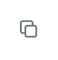

# 组件库

按钮、搜索框、复制图标分别存放，互不依赖；每个组件都能单独引入、单独预览。按钮和搜索框为胶囊圆角，复制功能只显示一个小图标，颜色可自行配置。

## 样式预览

### 按钮



### 搜索框



### 复制图标



## 按钮用法

源码：[button/button.css](button/button.css) · 独立演示：[button/index.html](button/index.html)

只需要按钮自己的 CSS，无需 JavaScript。

```html
<link rel="stylesheet" href="button/button.css">
<button class="ui-pill-button" type="button" aria-label="申请配置"><span aria-hidden="true">↗</span></button>
```

只保留箭头，不显示文字。接入项目时把 `aria-label` 改成实际操作名称，并绑定所需操作。

## 搜索框用法

源码：[search/search.css](search/search.css)、[search/search.js](search/search.js) · 独立演示：[search/index.html](search/index.html)

```html
<link rel="stylesheet" href="search/search.css">
<script src="search/search.js" defer></script>
<div class="ui-search" data-ui-search>
  <svg class="ui-search__icon" viewBox="0 0 24 24" fill="none" stroke="currentColor" stroke-width="2" aria-hidden="true"><circle cx="10.5" cy="10.5" r="6.5"/><path d="m16 16 5 5"/></svg>
  <input class="ui-search__input" type="text" inputmode="search" enterkeyhint="search" placeholder="搜索关键词…" aria-label="搜索关键词">
  <button class="ui-search__clear" type="button" aria-label="清除搜索词" hidden>×</button>
</div>
```

内部输入区无边框，点击或键盘聚焦时只高亮外层。JavaScript 提供清除功能；实际搜索逻辑由接入项目实现。

## 复制图标用法

源码：[copy-button/copy-button.css](copy-button/copy-button.css)、[copy-button/copy-button.js](copy-button/copy-button.js) · 独立演示：[copy-button/index.html](copy-button/index.html)

只引入复制图标自己的文件，不需要普通按钮或搜索框。图标为 18px，无背景、无边框，默认点击区域为 32 × 32px，不占整行。

```html
<link rel="stylesheet" href="copy-button/copy-button.css">
<script src="copy-button/copy-button.js" defer></script>
<button class="ui-copy" type="button" data-ui-copy data-copy-text="这是一段可复制的内容" aria-label="复制内容">
  <svg class="ui-copy__icon ui-copy__idle" viewBox="0 0 24 24" fill="none" stroke="currentColor" stroke-width="1.8" aria-hidden="true"><rect x="8" y="8" width="12" height="12" rx="2"/><path d="M16 8V5a2 2 0 0 0-2-2H5a2 2 0 0 0-2 2v9a2 2 0 0 0 2 2h3"/></svg>
  <svg class="ui-copy__icon ui-copy__done" viewBox="0 0 24 24" fill="none" stroke="currentColor" stroke-width="2" aria-hidden="true"><path d="m5 12 4 4L19 6"/></svg>
</button>
```

通过 `data-copy-text` 设置复制内容；也可替换为 `data-copy-target="元素ID"`（不带 #），复制指定输入框的 value 或普通元素的 textContent。两者同时存在时优先读取目标元素。

成功后图标变为对勾，按钮下方提示“已复制”，3 秒后复原。空内容与失败会显示对应提示。优先使用 HTTPS/localhost 下的 Clipboard API，无该 API 时尝试兼容方式。

## 分别配置颜色

直接引用时普通按钮默认绿色，复制图标默认灰绿色。以下配置放在组件 CSS 后面，分别修改，互不影响：

```css
/* 普通按钮。 */
.ui-pill-button {
  --ui-accent: #2563eb;
  --ui-accent-hover: #1d4ed8;
  --ui-focus: #93c5fd;
  color: #fff;
}

/* 复制图标。 */
.ui-copy {
  --ui-copy-color: #617369;
  --ui-copy-hover: #007458;
  --ui-focus: #5bd4b3;
}
```

按钮和搜索框默认宽度为父容器的 100%，最小高度为 50px，圆角为 9999px，可分别设置 max-width。复制图标保持紧凑尺寸，触屏设备上点击区域为 44 × 44px，图标本身仍为 18px。下载后打开各目录的 index.html 可独立预览，根目录 index.html 按一行一个组件展示。
