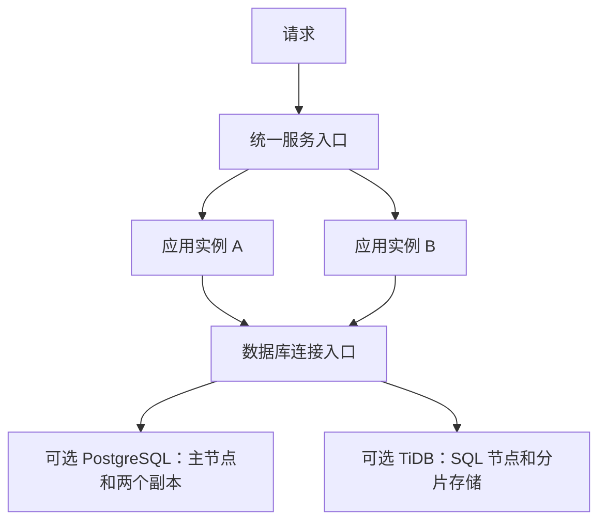

# 通用分布式部署工具

每个程序提供一个容器镜像和一份 JSON 配置，使用同一条命令部署应用实例及可选数据库。应用无需引用特定语言的 SDK；整个 `deployment/` 目录可复制到其他仓库，也可以在 CI 中调用。

**交付的是可复用部署工具，不是已经运行的云平台。** 当前已完成离线测试与官方 API 结构校验，尚未在真实 Kubernetes 集群中做安装、故障切换或数据恢复验证。

## 可以复用到哪些程序

| 程序 | 接入方式 |
| --- | --- |
| Node.js、Python、Java、Go、PHP、.NET 等 Web/API 服务 | 将 HTTP 服务封装为镜像，提供端口和健康检查路径 |
| React、Vue 等前端 | 先构建，再用 HTTP 服务器镜像提供静态文件；SSR 按 Web 服务接入 |
| 队列消费者、后台 Worker | 使用 worker 模式，明确允许并行执行并处理幂等性 |
| 桌面 GUI、依赖单机内存/SQLite 文件的程序、单实例定时任务 | 需要先改造，不能通过增加副本直接获得正确的分布式行为 |

工具不会自动编译任意语言的源码，也不会替程序改写数据库驱动、SQL、会话或业务锁。

## 两种数据库模式

| 配置值 | 生成的拓扑 | 应用驱动 |
| --- | --- | --- |
| `postgres-ha` | CloudNativePG 管理 3 个 PostgreSQL 实例：1 主、2 副本；提交等待至少 1 个同步副本 | PostgreSQL |
| `tidb-distributed` | TiDB Operator 管理 3 PD、3 TiKV、2 TiDB；数据分片及多副本，多个 SQL 节点提供访问 | MySQL 兼容驱动，仍需验证 SQL 兼容性 |
| 不填写 `database` | 只部署应用，可通过已有 Secret 连接其他数据库 | 由应用决定 |

PostgreSQL 模式提供主从高可用，并非多主写入。同步副本不足时会阻塞写入。TiDB 模式提供分片分布式能力；SQL 节点并不各存一份独立数据库。两个模式不能原地随意互换：工具会拒绝改变已有应用的数据库模式，需要新名称、数据迁移和应用适配。参见 [CloudNativePG 同步复制](https://cloudnative-pg.io/docs/1.28/replication/) 与 [TiDB 集群配置](https://docs.pingcap.com/tidb-in-kubernetes/stable/configure-a-tidb-cluster/)。



## 一次性准备

- 控制端安装 Python 3.9+ 与 `kubectl`，配置可用的 kubeconfig。工具本身无第三方 Python 依赖。
- 准备支持所用 Operator 的 Kubernetes 集群（本工具使用 Kubernetes 1.30+ 的拓扑字段；请选择仍受支持的版本）。应用至少需要 2 个可调度节点；启用任一数据库模式至少需要 3 个可调度节点，且有足够的 CPU、内存和持久化存储。
- 数据库需要有效的 StorageClass。示例的 `replace-with-your-storage-class` 必须替换；生产存储应设置合适的保留策略、容量和故障域。
- PostgreSQL 模式预先安装 [CloudNativePG Operator](https://cloudnative-pg.io/docs/1.28/installation_upgrade/)；TiDB 模式预先安装 [TiDB Operator](https://docs.pingcap.com/tidb-in-kubernetes/stable/deploy-tidb-operator/)。工具不会自动安装或升级集群级 Operator。
- 目标 namespace 必须已存在。执行账号需要读取节点/CRD/StorageClass，以及操作目标 namespace 内应用、数据库资源和 Secret 的权限。

这部分环境准备只需做一次。同一集群之后可以复用给多个程序。多台机器在同一故障域内不代表跨地域容灾；控制平面、存储、入口也需按实际可用性目标部署。

## 每个新程序的用法

选择一个配置例子，复制成自己程序的 `app.deploy.json`：

- [app.example.json](app.example.json)：仅应用。
- [postgres.example.json](postgres.example.json)：应用＋PostgreSQL 高可用。
- [tidb.example.json](tidb.example.json)：应用＋TiDB 分布式数据库。
- [worker.example.json](worker.example.json)：可并行后台任务。

替换应用名称、真实镜像、端口和存储类。镜像示例用于说明字段，不应原样用于生产；请固定经过验证的版本或 digest，包括 TiDB 初始化镜像。默认资源是起始配置，尤其 Java 和 TiDB 需要按负载调整；TiDB 示例仅数据库就申请约 11 核 CPU、22 GiB 内存与 6 块持久卷，不能按小型单数据库估算。

```sh
# 生成配置，不连接集群，不执行部署。
python deployment/deploy.py render --config app.deploy.json --output rendered/app.json

# 检查节点、Operator、存储类及服务端 API 校验，不实际创建资源。
python deployment/deploy.py check --config app.deploy.json --context my-cluster

# 环境已准备好后，统一命令部署。
python deployment/deploy.py deploy --config app.deploy.json --context my-cluster

# 查看应用和数据库状态。
python deployment/deploy.py status --config app.deploy.json --context my-cluster
```

Windows PowerShell 可使用相同命令。`my-cluster` 是 kubeconfig 中的 context 名称；工具不隐式选择当前 context。

部署顺序：前置检查 → 全部资源服务端 dry-run → 数据库及初始化 → 等待数据库就绪 → 应用滚动发布 → 核对就绪实例分布于不同节点。TiDB 初始化密码首次部署随机生成，仅写入 Kubernetes Secret；重复部署不覆盖已有密码。PostgreSQL 应用密码由 Operator 生成。

默认应用入口是 `ClusterIP`，只供集群内部访问。要对外提供服务，可以将应用的 `serviceType` 改成 `LoadBalancer`（需集群具备负载均衡实现），或将 Service 接入已有 Gateway/Ingress。TLS、域名和入口控制器由环境配置，工具不会自动签发证书。数据库入口始终留在集群内部。见 [Kubernetes Service](https://kubernetes.io/docs/concepts/services-networking/service/)。

## 程序需要遵守的接入约定

HTTP 服务监听 `0.0.0.0` 和配置的 `port`，工具同时提供 `PORT` 环境变量，但具体框架需要主动读取它。默认 `/healthz` 只反映进程自身是否健康，`/readyz` 反映能否接收请求。路径可配置。不要在数据库短时故障时让 liveness 失败而导致全体应用反复重启。[探针说明](https://kubernetes.io/docs/concepts/workloads/pods/probes/)

启用数据库后，工具注入以下变量；应用必须主动读取并交给自己的驱动/ORM：

| 变量 | 含义 |
| --- | --- |
| `DB_DRIVER` | `postgresql` 或 `mysql` |
| `DB_HOST` / `DB_PORT` | 自动生成的数据库连接入口 |
| `DB_NAME` / `DB_USER` | 初始库与非 root 应用用户，均为 `app` |
| `DB_PASSWORD` | 从 Kubernetes Secret 引用，不写入 JSON 配置 |

例如 Python 读取 `os.environ`，Node.js 读取 `process.env`，Java 读取 `System.getenv`，Go 读取 `os.Getenv`，PHP 读取 `getenv`，.NET 读取 `Environment.GetEnvironmentVariable`。这些是统一配置约定，数据库连接库和 ORM 仍由项目选择。

登录会话用共享存储或可验证令牌，上传文件用对象存储，后台任务用队列并实现幂等。不要让每个副本各自执行同一份数据库迁移或定时任务。进程应处理 SIGTERM，在 30 秒终止窗口内停止接收请求并完成清理。

Worker 模式不创建 HTTP Service/探针，默认只由进程退出触发重启；卡死检测需由应用实现。`parallelSafe:true` 表示你已确认多消费者、任务重试和重复消费不会产生错误。

## 配置扩展

`env` 存放普通环境变量，值必须是字符串；已有 Secret 可通过 `secretName` 注入。私有镜像仓库使用 `imagePullSecret` 引用当前 namespace 中已有的拉取凭据。`command`、`args` 接受字符串数组，覆盖镜像默认启动命令。`resources` 覆盖应用资源申请和限制。启用数据库时 `DB_*` 由工具管理。

修改 `replicas` 后重复部署即可调整应用副本数，更新镜像版本后重复部署即可滚动更新。数据库副本数由当前两个配置固定为上述拓扑；数据库进一步扩容、调参、备份计划和 TLS 请按对应 Operator 文档配置。

## 数据和失败处理

本工具不实现数据库备份、恢复演练、跨地域复制或自动数据迁移。多副本不能代替备份；投产前需补齐对应 Operator 的备份、访问控制、传输加密及监控方案。删除应用不会自动清理数据库和持久卷，工具也没有自动删库命令。

如果服务端校验失败，不会应用资源。如果创建资源后等待超时，工具返回失败，但已创建的数据库、Secret 或应用可能保留，不会自动回滚数据库。用 `status` 和 `kubectl describe` 排查。应用回滚可使用指定 context 的 `kubectl rollout undo deployment/<name>`，并同步修改配置中的镜像版本；数据库大版本升级不应按普通应用回滚处理。

## 验证与已知边界

```sh
python -m unittest discover -s deployment/tests -v
```

已进行配置验证、两种数据库生成、凭据保留、部署顺序、dry-run 失败阻断等离线测试；示例生成资源已对照 Kubernetes v1.35 OpenAPI、CloudNativePG release-1.28 CRD、TiDB Operator v1.6.6 CRD 校验。API 结构通过不代表真实集群已验证，镜像拉取、存储供应、数据库初始化、SQL 连接、节点故障切换和恢复仍需在目标环境验证。
